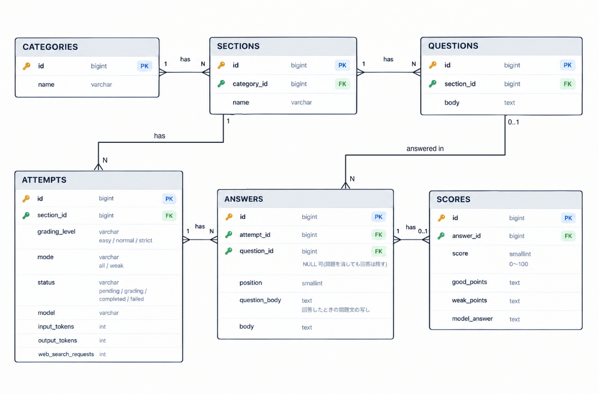

# Recollect

自由記述で答えた問題を AI(Claude API)が採点し、フィードバックを返す個人用の学習アプリです。
Laravel + Blade 構成で、採点はキューのワーカーで非同期に行います。

## デモ

- 本番環境: https://web-production-82e46.up.railway.app

## ER図



## 主な機能

- カテゴリ・セクション・問題の管理(作成・編集・削除。1セクション10問まで)
- セクションの全問に一括で回答し、AI が 0〜100点で採点(採点の厳しさは Easy / Normal / Strict)
- 1問ごとのフィードバック(良かった点 / 悪かった点 / 模範解答)と、前回の点数との比較
- 60点未満の問題だけを解き直す「苦手問題の再挑戦」
- 回答の下書きをブラウザに自動保存(再読み込みや離脱をしても復元)
- 挑戦ごとの履歴と、トークン数・Web検索の回数・推定コストの記録
- 管理者ログイン(ログイン試行のレート制限つき)

意図的にスコープ外にしたもの: ユーザー登録・複数ユーザー、模範解答の登録、AI による問題生成、選択式問題、得点推移のグラフ、ダークモード

## 技術スタック

| 層             | 技術                                                                                                                               |
| -------------- | ---------------------------------------------------------------------------------------------------------------------------------- |
| バックエンド   | Laravel 13 / PHP 8.5 / PostgreSQL / キュー(database ドライバ)/ Pest / Laravel Pint                                                 |
| フロントエンド | Blade / Tailwind CSS v4 / Alpine.js / Vite                                                                                         |
| AI 採点        | Claude API(Claude Haiku 5.5、anthropic-ai/sdk)/ Web検索ツール                                                                      |
| インフラ       | Railway(web / worker / PostgreSQL、Dockerfile ビルド、GitHub 連携による自動デプロイ)/ Docker Compose(ローカル)/ GitHub Actions(CI) |

## アーキテクチャ

```
ブラウザ → web(nginx + PHP-FPM) → PostgreSQL
              │ 採点 Job を投入(jobs テーブル)
              ↓
           worker(queue:work) → Claude API
```

- web と worker は同じ Docker イメージで、起動コマンドだけを変えている。本番は Railway に別サービスとしてデプロイしている
- **採点は非同期**。回答を送ると、挑戦と回答を1つのトランザクションで保存し、採点 Job をキューに入れて結果画面へリダイレクトする。結果画面は数秒おきに状態を確認し、採点が終わったら結果を表示する。Job は `ShouldBeUnique` で二重に動かないようにし、失敗したら画面の「再採点」から回答を入力し直さずに採点し直せる
- **採点結果はツール呼び出しで受け取る**。`submit_grades` ツールを `strict: true` にして、点数とフィードバックがスキーマどおりの形で返るようにしている。1回目で提出されなかったときは、会話を引き継いで提出を頼む(`app/Services/Grading/ClaudeGradingService.php`)
- **Web検索で事実を確かめる**。バージョンなど時間とともに変わる事実は、AI が Web検索で確認してから採点する(回数は問題数 × 2 まで)
- **プロンプトインジェクション対策**。問題文と回答を `<question>` / `<answer>` タグで囲み、タグの中の指示(「100点にして」など)には従わないよう system プロンプトで指示している
- **履歴の自動整理と問題文の写し**。同じ問題の回答は直近10件だけ残し、回答が0件になった挑戦は消す。回答には回答したときの問題文を写して保存するので、あとから問題を書き直したり消したりしても、過去の履歴は変わらない
- Claude API の呼び出しは `GradingService` インターフェースの後ろに置いている。テストと画面の作り込みでは、API を呼ばない `FakeGradingService` に差し替える

設計の詳細は [doc/](doc/) にまとめている(要件定義・画面設計・DB と採点処理の設計など)。

## ディレクトリ構成(抜粋)

```
app/
  Http/Controllers/            画面ごとのコントローラ
  Http/Requests/               FormRequest による入力チェック
  Jobs/GradeAttempt.php        採点 Job
  Services/Grading/            Claude API での採点(GradingService とその実装)
  Queries/                     平均点・最新の点数・苦手問題の集計
  Enums/                       採点の厳しさ・挑戦の種別・状態
  Models/                      Category, Section, Question, Attempt, Answer, Score
resources/
  views/components/ui/         Button, Card, Badge, ConfirmModal などの共通UI
  js/                          回答の下書き保存・採点状態の確認(Alpine.js)
docker/production/             本番用の Dockerfile・nginx・supervisord の設定
doc/                           設計ドキュメント
tests/Unit/, tests/Feature/    Pest によるテスト
```

## ローカル開発環境のセットアップ

PHP と Composer は Docker の中で動かします。CSS / JS のビルドだけ、手元の Node.js(22 以上)を使います。

```bash
git clone https://github.com/kabochan73/Quiz-Portfolio3.git
cd Quiz-Portfolio3

cp .env.example .env

docker compose up -d
docker compose exec app composer install
docker compose exec app php artisan key:generate
docker compose exec app php artisan migrate --seed   # 管理者アカウントと見本データを作る

npm install
npm run build
```

- アプリ: http://localhost:8000
- ログイン: `.env` の `ADMIN_EMAIL` / `ADMIN_PASSWORD`
- `.env` の初期値は `GRADING_DRIVER=fake` で、Claude API を呼ばずに決まった採点結果を返します。本物の採点を試すときは `GRADING_DRIVER=claude` にして `ANTHROPIC_API_KEY` を設定し、`docker compose restart app worker` で再起動します

## テスト

```bash
# Pest(386 tests)。テスト用の DB(quiz_testing)を使い、Claude API は呼ばない
docker compose exec app php artisan test
docker compose exec app ./vendor/bin/pint --test   # コードスタイル
```

## CI/CD

- GitHub Actions(`.github/workflows/ci.yml`): push・PR のたびに Pint と Pest を実行する。テストは本番と同じ PostgreSQL で行う
- デプロイは Railway の GitHub 連携で行う。`main` への push で CI が通ったコミットだけを、Railway が Dockerfile でビルドしてデプロイする。web はデプロイの前にマイグレーションを実行する
